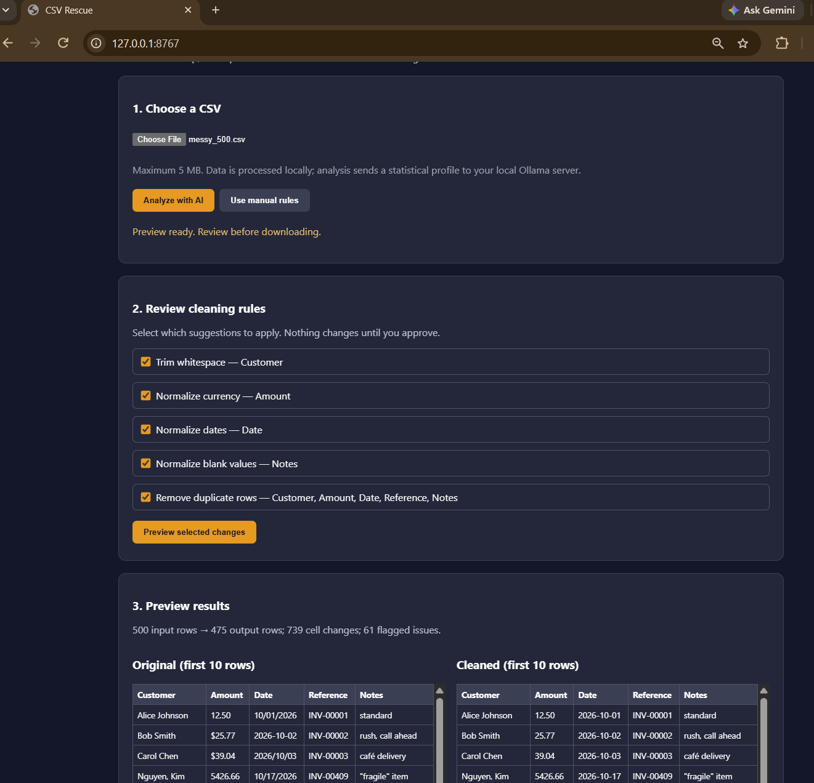

# CSV Rescue

**Local-first CSV cleaning with AI-assisted recommendations, human approval, and auditable changes.**

CSV Rescue helps turn messy CSV files into consistent, usable data without blindly trusting AI-generated transformations.

Upload a CSV, inspect cleaning recommendations, preview the results, and approve the changes before downloading a cleaned copy. Your original file remains untouched.

Built by&#x20;

[Blacktop Logic](https://github.com/BlacktopLogic).

## Application preview



## Features

- **Whole-file profiling:** Python examines every row to identify formatting inconsistencies, blank placeholders, and exact duplicates.
- **Local AI recommendations:** Ollama and Qwen3 suggest cleaning rules based on the file's statistical profile.
- **Evidence-based safeguards:** Recommendations are checked against measurable data issues.
- **Human approval:** Select which cleaning rules to apply.
- **Before-and-after preview:** Compare original and cleaned data before downloading.
- **Change tracking:** Inspect individual cell modifications and flagged issues.
- **Conservative cleaning:** Unrecognized dates and ambiguous currency values are flagged rather than guessed.
- **Local processing:** CSV data is processed on your computer.

### Supported cleaning operations

| Operation          | Behavior                                                              |
| ------------------ | --------------------------------------------------------------------- |
| Trim whitespace    | Removes leading and trailing whitespace                               |
| Normalize currency | Converts supported dollar amounts into two-decimal numeric strings    |
| Normalize dates    | Converts recognized date formats into `YYYY-MM-DD`                    |
| Normalize blanks   | Converts placeholders such as `N/A`, `null`, and `-` into empty cells |
| Remove duplicates  | Removes subsequent rows matching the selected key columns             |

All operations are implemented in deterministic Python code. **The AI recommends rules; it does not generate or execute cleaning code.**

## Requirements

- Python 3.10 or newer
- Windows, macOS, or Linux with Python available
- [Ollama](https://ollama.com/) for AI-assisted analysis
- Qwen3 8B model for the default AI configuration

Ollama is optional for manual cleaning. AI recommendations require the local Ollama server and the configured model.

## Installation

Clone the repository:

```bash
git clone https://github.com/BlacktopLogic/csv-rescue.git
cd csv-rescue
```

Create a Python virtual environment.

**Windows PowerShell:**

```powershell
py -m venv .venv
.\.venv\Scripts\Activate.ps1
python -m pip install -r requirements.txt
```

**macOS / Linux:**

```bash
python3 -m venv .venv
source .venv/bin/activate
python -m pip install -r requirements.txt
```

### Set up local AI

Install Ollama, then download the configured model:

```bash
ollama pull qwen3:8b
```

Make sure the Ollama server is running locally at `http://127.0.0.1:11434`.

The current application is configured to use `qwen3:8b`. To change models, edit `OLLAMA_MODEL` in `csv_rescue/app.py`.

## Run CSV Rescue

From the project directory, with the virtual environment activated:

```bash
python -m uvicorn csv_rescue.app:app --host 127.0.0.1 --port 8767
```

Open:

[**http://127.0.0.1:8767**](http://127.0.0.1:8767)

To try the application, upload the included `samples/messy.csv` file.

### Cleaning workflow

1. **Choose a CSV file.** Upload a UTF-8 CSV with named, unique columns.
2. **Analyze with AI or use manual rules.** Python profiles the file, and optional local AI contributes recommendations.
3. **Review recommendations.** Select the operations you want to apply.
4. **Preview changes.** Compare the first ten rows before and after cleaning, along with change details and flagged issues.
5. **Approve and download.** Save `cleaned.csv`. Your original file is not overwritten.

**Important:** Deduplication removes rows from the output. Review the preview carefully before approving it, particularly when repeated records may represent legitimate transactions.

## Example results

During development, CSV Rescue was tested against a synthetic 500-row dataset containing inconsistent names, currencies, dates, blank placeholders, and duplicate records.

| Measurement                     | Result |
| ------------------------------- | -----: |
| Input rows                      |    500 |
| Output rows                     |    475 |
| Recorded cell changes           |    739 |
| Flagged issues                  |     61 |
| Exact duplicate rows identified |     25 |

These figures describe one test dataset, not a guarantee of results for other files.

The test demonstrated preservation of quoted CSV fields, embedded commas, accented names, and original values that could not be safely normalized.

## Privacy and safety

CSV Rescue is designed to run locally.

- The FastAPI server binds to `127.0.0.1` by default in the documented launch command.
- AI analysis sends a compact file profile to the locally configured Ollama server.
- CSV contents are not intentionally sent to an external AI service.
- AI recommendations are restricted to supported cleaning operations.
- The application does not execute AI-generated Python code.
- The original CSV file is never overwritten.
- Cleaning requires user selection and approval.

**Privacy note:** The file profile may include sample values from the CSV. Local-first processing does not eliminate the need to protect sensitive files or secure the computer running Ollama.

## Known limitations

- Maximum upload size: **5 MB**.
- CSV files must be UTF-8 encoded and have named, unique columns.
- The preview displays up to ten original and cleaned rows, 30 changes, and 30 flagged issues. It is not a complete downloadable audit report.
- Supported dates include `YYYY-MM-DD`, `MM/DD/YYYY`, `MM/DD/YY`, and `YYYY/MM/DD`.
- Ambiguous international date conventions are not automatically resolved.
- Currency normalization is intended for supported dollar-formatted values, not high-precision financial calculations.
- Cleaning rules run in sequence. Normalization can cause previously different records to become identical before deduplication.
- Duplicate records may be legitimate; users are responsible for approving their removal.
- AI suggestions may vary between runs. Python-generated candidates provide a deterministic baseline for supported patterns.
- The current interface is designed for local, single-user operation rather than public internet deployment.

## Automated tests

Run:

```bash
python -m pytest -v
```

The current test suite contains **15 passing tests**, covering currency and date normalization, ambiguous values, blank placeholders, duplicate handling, CSV quoting and Unicode, repeatability, and malformed inputs.

## Project structure

```text
csv-rescue/
├── csv_rescue/
│   ├── app.py          # FastAPI server and browser interface
│   ├── core.py         # Deterministic cleaning engine
│   └── profiler.py     # Whole-file analysis and rule candidates
├── samples/            # Synthetic example CSV files
├── tests/              # Automated regression tests
├── requirements.txt
└── README.md
```

## Project status

CSV Rescue is a working prototype developed for the 2026 Hacktoberfest open-source AI challenge.

Potential future improvements include downloadable full audit reports, stronger format detection, expanded API tests, and more detailed duplicate-review controls.

## License

An open-source license is being selected and will be added to the repository before release.

---

**Blacktop Logic** — Practical software. Built to move.
